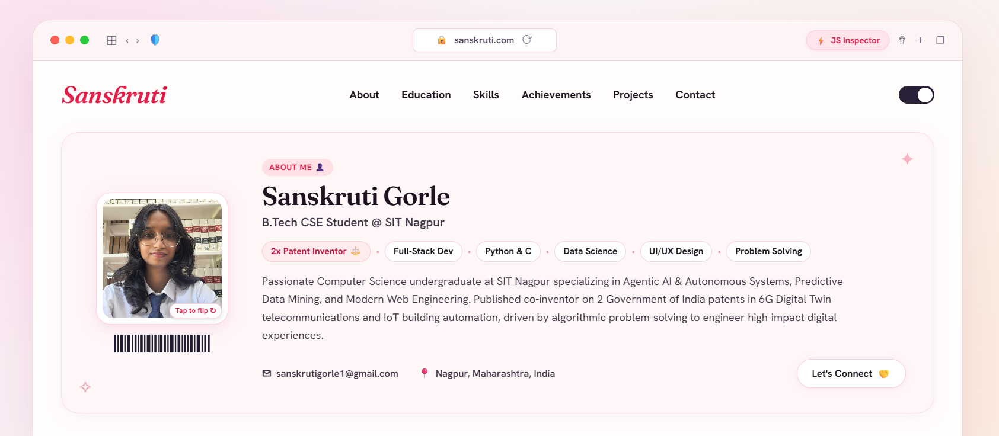
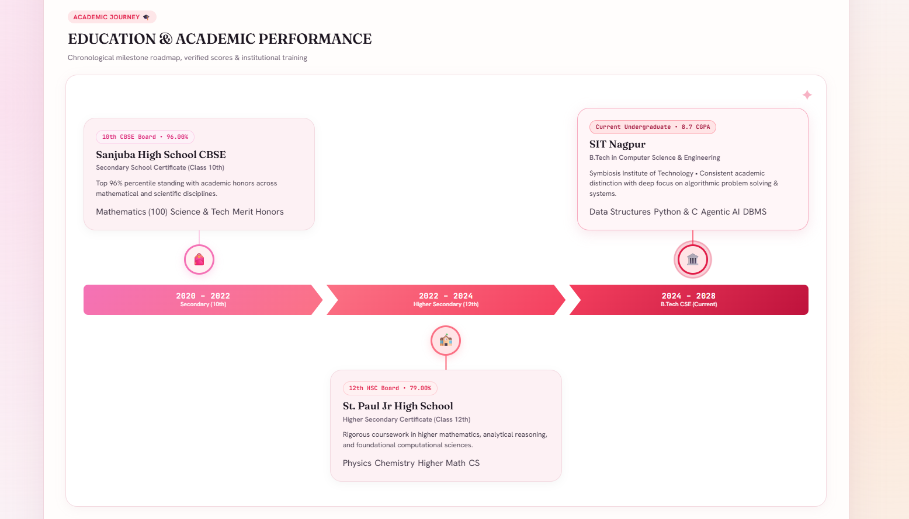
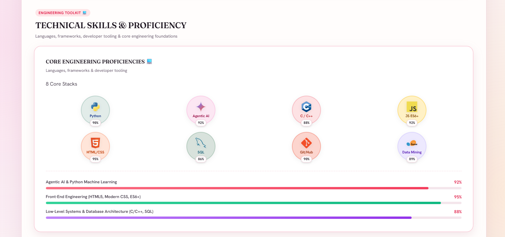
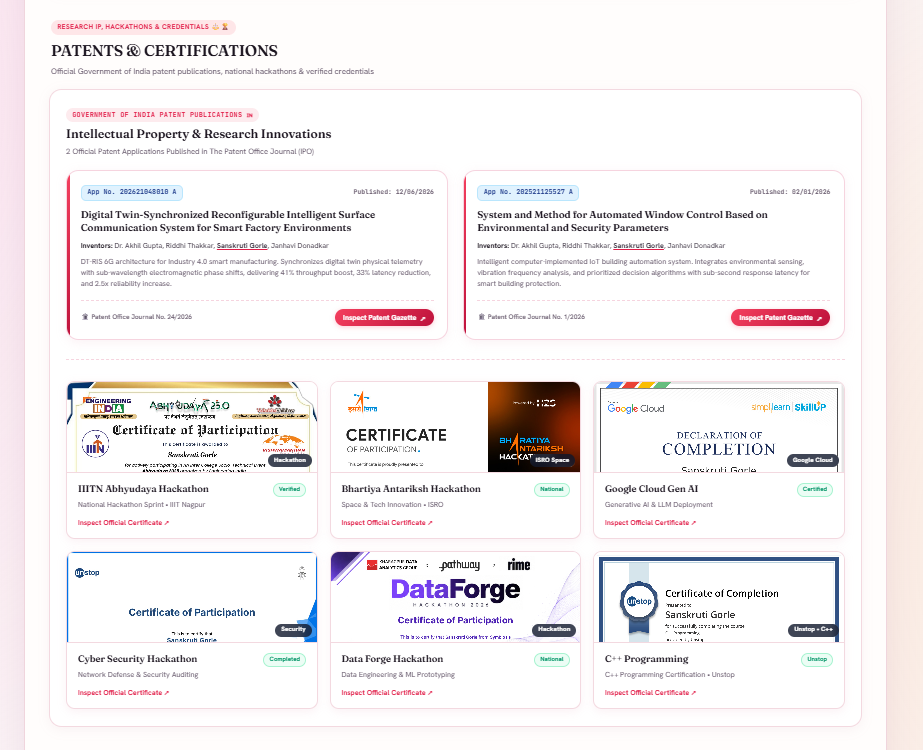
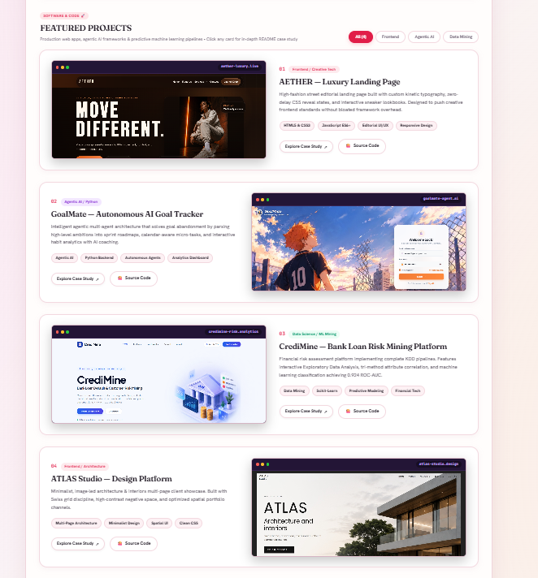
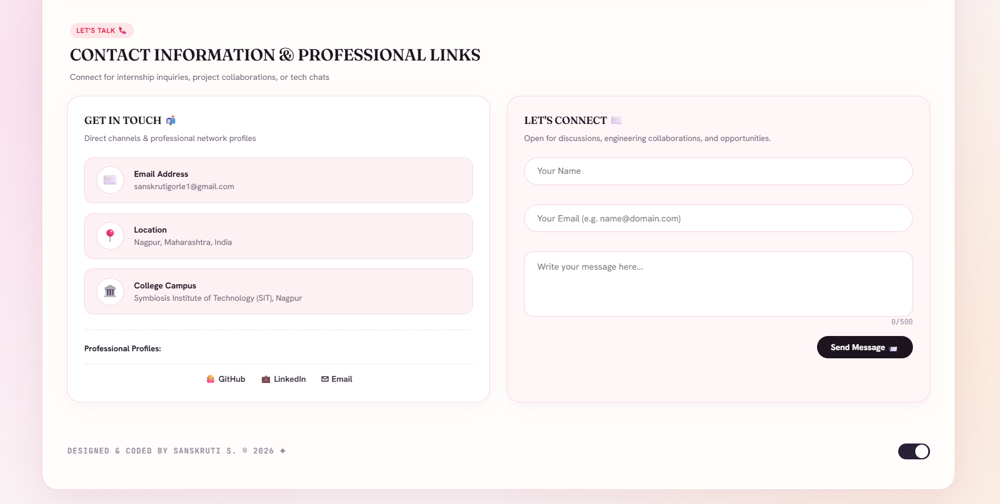

<div align="center">

# 🌸 Sanskruti Gorle — Modern Developer Portfolio
### Semantic HTML5 · Responsive CSS Bento Grid · Modular ES6+ JavaScript

A production-grade, interactive developer portfolio showcasing computer science engineering projects, official patent publications, verified hackathon credentials, and academic milestones within a custom **Mac Safari window container** and soft **Rose-Gold / Pink bento grid aesthetic**.

<br>


<br><br>

`01` Modern ES6+ Architecture &nbsp;·&nbsp; `02` Mac Safari Window UI &nbsp;·&nbsp; `03` Patents & Credentials Lightbox &nbsp;·&nbsp; `04` Interactive JS Inspector &nbsp;·&nbsp; `05` LocalStorage State

</div>

---

## 📸 Visual Previews

### 1. Hero & Interactive Profile Card
Interactive Mac Safari header bar with real-time address bar, live refresh, flip avatar card (cartoon illustration ⇄ real photo), barcode visual, and direct contact CTAs.

<p align="center">
  
</p>

---

### 2. Education & Academic Performance Roadmap
Chronological milestone roadmap with directional chevron progression markers, board merit percentiles, and current B.Tech CSE details at SIT Nagpur.

<p align="center">
  
</p>

---

### 3. Technical Skills & Proficiency Deck
Circular tech stack badges with authentic SVGs/logos (Python, Agentic AI, C/C++, JS ES6+, HTML5/CSS3, SQL, Git/GitHub, Data Mining) alongside dynamic skill proficiency progress bars.

<p align="center">
  
</p>

---

### 4. Patents & National Hackathon Certifications
Spotlight on **2 Official Government of India Patent Publications** published in the Patent Office Journal (IPO) and a unified interactive 6-card credential deck with single-click document modal inspector.

<p align="center">
  
</p>

---

### 5. Featured Projects & Interactive Case Studies
Featured showcase of 4 production-grade applications:
- **AETHER** — Luxury Streetwear Landing Page & Kinetic Editorial UI
- **GoalMate** — Autonomous Agentic AI Goal Tracker
- **CrediMine** — Bank Loan Risk Mining & Machine Learning Platform
- **ATLAS Studio** — Architectural Design Platform & Spatial UI

<p align="center">
  
</p>

---

### 6. Contact Information & Professional Links
Direct communication channels, professional profiles (GitHub, LinkedIn, Email), and an interactive contact inquiry form.

<p align="center">
  
</p>

---

## 🛠️ Key Technical Features & JavaScript Architecture

| Module | Core Concept | Implementation Detail |
| :--- | :--- | :--- |
| **Module 1: State Management** | Closure & IIFE | `AppState` encapsulated singleton with reactive pub/sub listeners. |
| **Module 2: Closures** | Scoped Encapsulation | `createFilterPipeline` & `createAutoSaveDraft` retaining lexical variables across async lifecycles. |
| **Module 3: Prototypes & OOP** | ES6 Classes & Inheritance | `ProjectItem` & `CertificateItem` inheriting from `BasePortfolioItem` displaying polymorphism with `renderCard()`. |
| **Module 4: Higher-Order Functions** | Functional Array Ops | Native `.filter()`, `.map()`, `.reduce()`, `.sort()`, and `.every()` for dataset transformations. |
| **Module 5: DOM & Event Delegation** | Bubbling & Capturing | Single delegated listener on `#unified-certificates-grid` and `#projects-deck-grid` handling modal triggers cleanly without memory leaks. |
| **Module 6: Storage API** | Browser Storage | `StorageService` managing visitor hit tracking, form drafts, and theme persistence via `localStorage` and `sessionStorage`. |
| **Module 7: Asynchronous API** | Promises & Async/Await | `loadPortfolioData()` fetching `portfolio-data.json` with robust fallback to `FALLBACK_DATA`. |
| **Module 8: Interactive Inspector** | Developer Tools | Built-in JavaScript Concepts Inspector modal accessible via the header pill or `Alt + J` viva keyboard shortcut. |

---

## 📂 Project Structure

```text
portfolio/
├── assets/
│   ├── icons/                  # Tech stack brand SVG vectors
│   ├── images/                 # Project screenshots, certificates & avatar graphics
│   ├── patents/                # Official published Government of India patent PDFs
│   └── screenshots/            # Portfolio UI visual documentation
├── app.js                      # Modular vanilla ES6+ application engine
├── index.html                  # Accessible HTML5 Mac Safari layout
├── portfolio-data.json         # External JSON dataset with fallback support
├── style.css                   # Custom responsive CSS with CSS variables & bento grid
└── README.md                   # Documentation & showcase
```

---

## 🚀 Running Locally

No bundler, Node.js runtime, or external build tool is required. The portfolio runs entirely natively in any modern web browser:

1. Clone or navigate to the repository directory:
   ```bash
   cd portfolio
   ```
2. Open `index.html` directly in your browser:
   - On Windows: Double-click `index.html` or run `start index.html`
   - On macOS: `open index.html`
   - On Linux: `xdg-open index.html`
3. Or serve using any lightweight static server:
   ```bash
   npx serve .
   # or
   python -m http.server 8000
   ```
